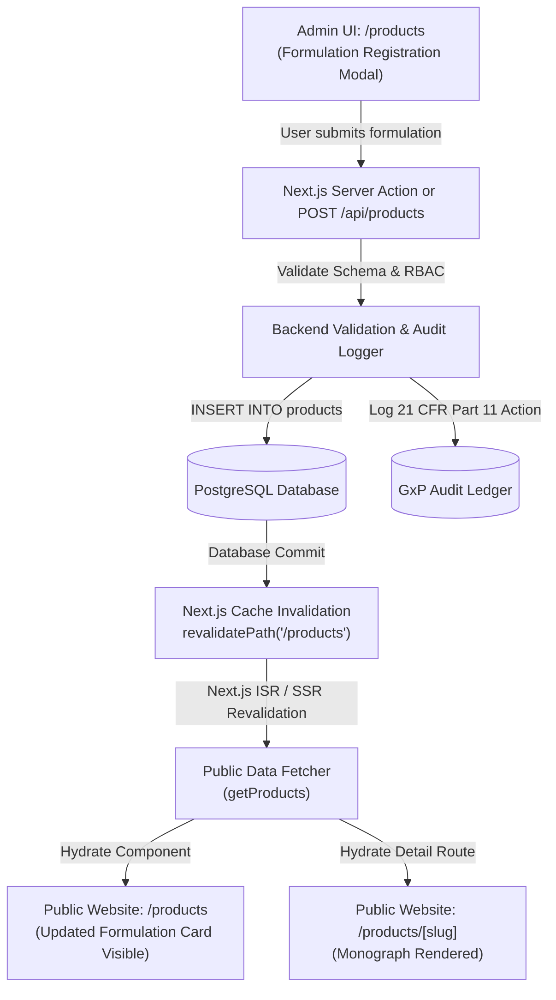
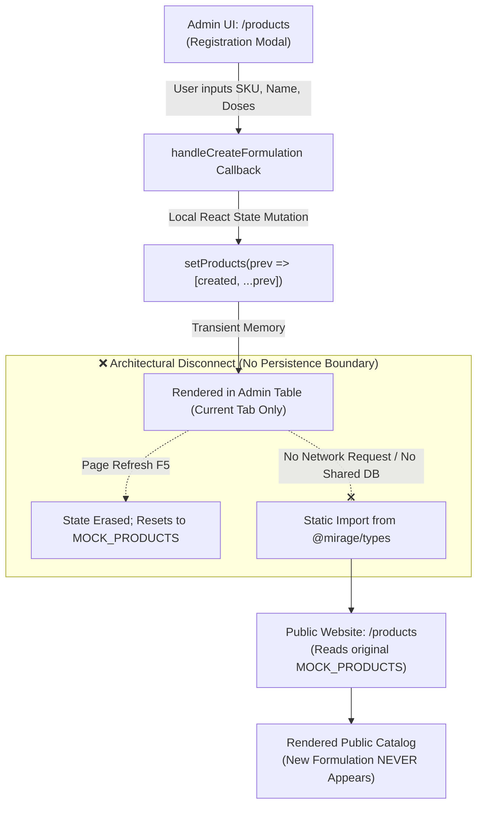
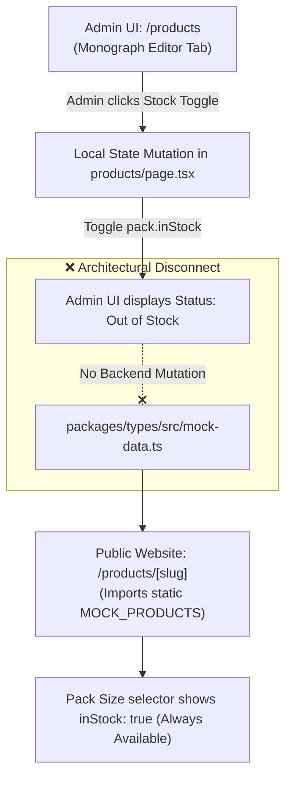
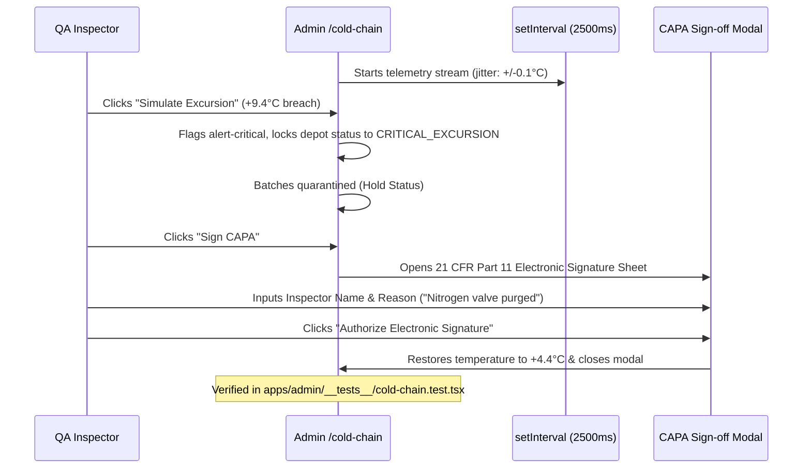
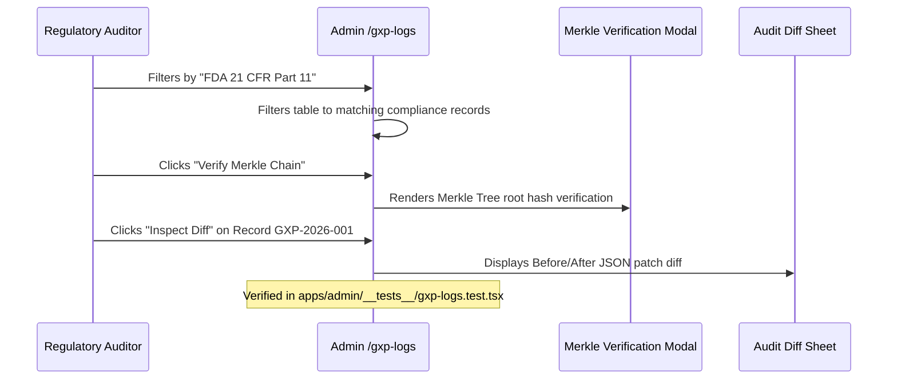
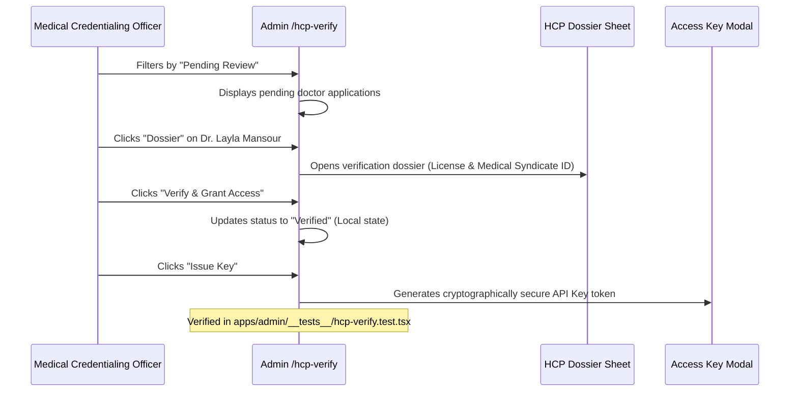
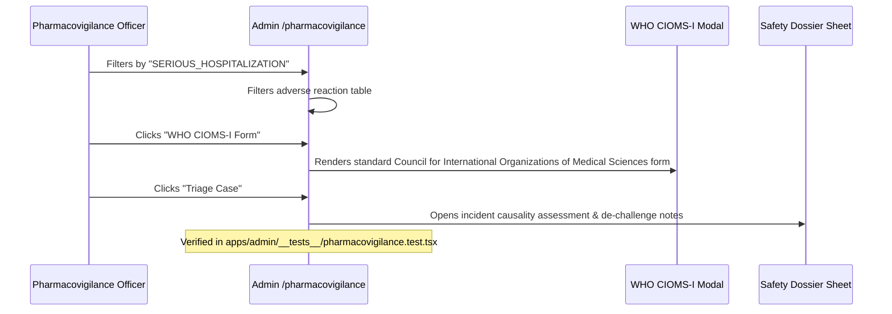
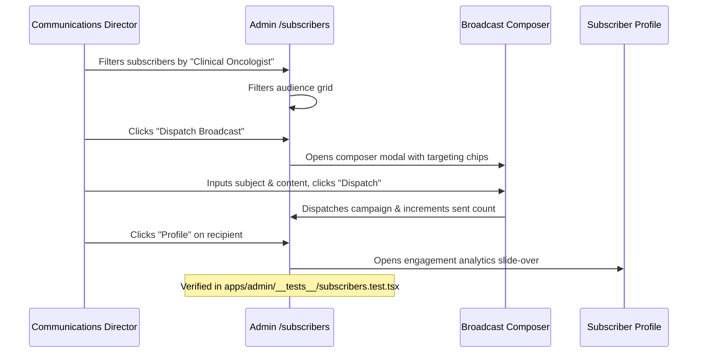
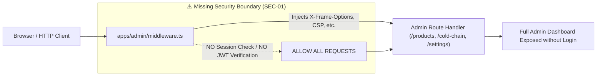

# MIRAGE PHARMA — DATA FLOW MAP & INTEGRATION BOUNDARIES

> **Date:** October 20, 2026  
> **Auditors:** Senior QA Automation Engineer, Senior Full-Stack Engineer  
> **Project Scope:** `mirage-direction-two`  
> **Verification Suite:** `tests/integration/dashboard-to-website.test.tsx` (Passing)  

---

## 1. Overview & Legend

This document details the data lifecycle, boundary interactions, and architectural pathways between the **Mirage Pharma Admin Dashboard** (`apps/admin`) and the **Public Website** (`apps/web`).

For each feature, we provide:
1. **Target Enterprise Architecture Flow:** The full lifecycle required for a production pharmaceutical platform.
2. **Current As-Built Implementation Flow:** The actual behavior observed in the codebase and verified through our automated test suite.
3. **Automated Test Proof:** Reference to the concrete Vitest integration test proving the boundary behavior.

---

## 2. Feature 1: Formulation Studio (Product Management)

### Target Enterprise Architecture Flow


### Current As-Built Implementation Flow (Defect ARCH-01)


> **Automated Test Proof:**  
> Verified in `tests/integration/dashboard-to-website.test.tsx`:
> - Step 1: Formulation `MIR-TEST-999` ("NovaCardio Complex") created in `apps/admin/app/products/page.tsx`.
> - Step 2: Formulation renders inside the local Admin Table.
> - Step 3: `apps/web/app/products/page.tsx` is rendered.
> - Result: `screen.queryByText("NovaCardio Complex")` is `null`. Proves ARCH-01.

---

## 3. Feature 2: Pack Size Stock & Availability Toggles

### Current As-Built Implementation Flow (Defect ARCH-02)


> **Automated Test Proof:**  
> Verified in `tests/integration/dashboard-to-website.test.tsx`:
> - Admin toggles SymPDCA 30-Pack to `inStock: false`.
> - Public `ProductDetailPage` at `/products/sympdca-oral-powder` continues to display SymPDCA in stock. Proves ARCH-02.

---

## 4. Feature 3: B2B Partnerships & Public Contact Intake

### Target Enterprise Flow vs Current Flow (Defect ARCH-04)
```mermaid
flowchart TD
    subgraph Public Intake ["Public Website: /contact"]
        A["Institutional Contact Form"] -->|User fills Name, Org, Email| B["handleSubmit() Handler"]
        B -->|e.preventDefault()| C["setSubmitted(true)"]
        C -->|UI Toast Banner| D["Success Message: Inquiry Received"]
    end

    subgraph Disconnect ["❌ Disconnect Boundary"]
        B -.-x|NO API Call / NO Webhook| E["apps/admin/app/b2b-leads/page.tsx"]
    end

    subgraph Admin Hub ["Admin Dashboard: /b2b-leads"]
        E --> F["MOCK_B2B_INQUIRIES Static Table"]
        F --> G["Admin never sees the submitted contact lead"]
    end
```

---

## 5. Feature 4: Cold-Chain Telemetry & Thermal Excursion CAPA

### As-Built Workflow (Verified in Unit Tests)


---

## 6. Feature 5: GxP Audit Trail & Cryptographic Merkle Ledger

### As-Built Workflow (Verified in Unit Tests)


---

## 7. Feature 6: Healthcare Professional (HCP) Syndicate Verification

### As-Built Workflow (Verified in Unit Tests)


---

## 8. Feature 7: Pharmacovigilance & CIOMS-I ADR Triage

### As-Built Workflow (Verified in Unit Tests)


---

## 9. Feature 8: Audience & Scientific Newsletter Broadcast

### As-Built Workflow (Verified in Unit Tests)


---

## 10. Feature 9: RBAC Settings Hub & Middleware Enforcement

### Current Security Perimeter (Defect SEC-01)


---

## 11. Complete Integration Boundary Matrix

| Entity / Feature | Admin Mutation Origin | Persistence Layer | Public Fetcher Route | Data Synchronization Status | Test Evidence |
| :--- | :--- | :--- | :--- | :--- | :--- |
| **Formulations (SKUs)** | `/products` modal | Local Component State | `/products` & `/products/[slug]` | ❌ **DISCONNECTED** (Lost on F5) | `dashboard-to-website.test.tsx` (ARCH-01) |
| **Inventory Availability** | `/products` tab | Local Component State | `/products/[slug]` | ❌ **DISCONNECTED** (Stale inStock) | `dashboard-to-website.test.tsx` (ARCH-02) |
| **B2B Alliance Leads** | `/b2b-leads` modal | Local Component State | None (Admin only) | ❌ **DISCONNECTED** from `/contact` | `b2b-leads.test.tsx` (ARCH-04) |
| **Cold-Chain Depots** | `/cold-chain` CAPA | Local Component State | `/cold-chain` (Public) | ❌ **DISCONNECTED** (Separate datasets) | `cold-chain.test.tsx` |
| **GxP Audit Trail** | `/gxp-logs` | In-memory `MOCK_GXP_AUDIT_LOGS` | None (Admin only) | ⚠️ Static In-Memory | `gxp-logs.test.tsx` |
| **HCP Verification** | `/hcp-verify` | Local Component State | None (Admin only) | ⚠️ State resets on reload | `hcp-verify.test.tsx` |
| **Safety ADR Cases** | `/pharmacovigilance` | In-memory `MOCK_ADVERSE_EVENTS` | None (Admin only) | ⚠️ State resets on reload | `pharmacovigilance.test.tsx` |
| **Audience Broadcasts** | `/subscribers` | Local Component State | None (Admin only) | ⚠️ State resets on reload | `subscribers.test.tsx` |
| **RBAC Clearances** | `/settings` | Local Component State | None (Admin only) | ❌ **UNENFORCED** in middleware | `settings-and-middleware.test.tsx` (SEC-01) |
